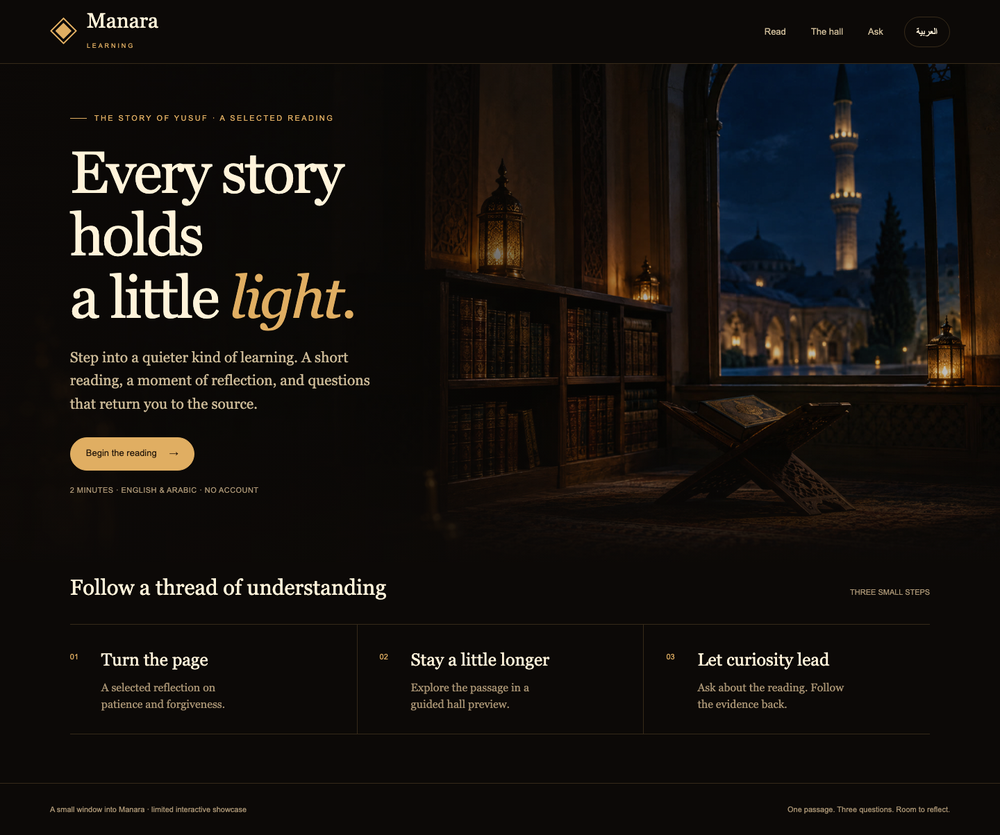
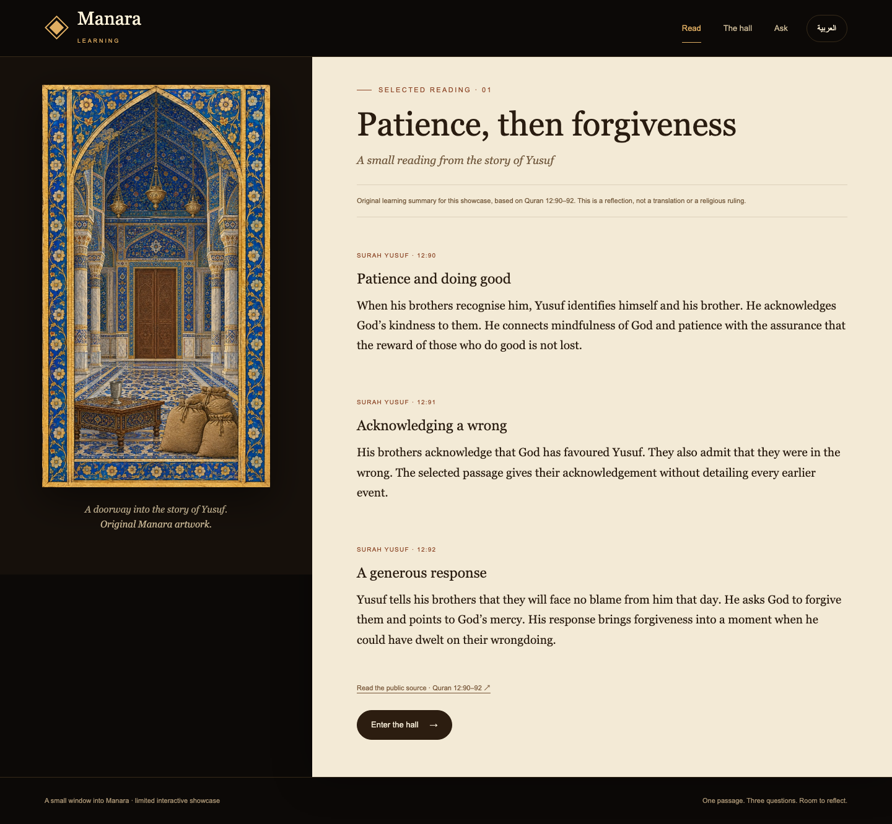

# Manara Learning

**A quiet place to read, explore and ask better questions.**

A learning assistant should help readers return to the material. Manara pairs an English/Arabic reading experience with questions whose answers point back to the selected source.

Built by **Mohammed Abumtary** · Node.js · bilingual browser UI · grounded model responses · persistent quotas

[Demo guide](docs/DEMO.md) · [Engineering notes](docs/ENGINEERING.md) · [Verification & boundaries](docs/VERIFICATION.md) · [Recorded walkthrough](media/walkthrough.webm)

## The experience

Choose a reading → switch language → explore the hall → ask → open the source.

A selected-content showcase with three authored bilingual reading notes, a reflection hall and recorded live grounded answers.

## Where the engineering matters

### Sources are part of the interaction

Answers link to a specific passage, and opening the citation moves the reader to the supporting text.

### Unsupported questions stay unsupported

The recorded journey includes a question that the selected reading cannot answer. The assistant states that limit instead of supplying an invented detail.

### A refresh is not a new allowance

Question limits survive refresh and restart. Session, concurrency and persistent spending controls bound the public-content experience.

## Verified in the demonstration

- 14 offline acceptance groups, including quotas, concurrency, restart persistence and Arabic decoding.
- Three recorded live questions: English answer, unsupported question and Arabic answer with a source jump.
- Eight EN/AR routes checked with automated accessibility tooling; no automated AA violations in that check.

## Explore the work

This repository is a presentation package: screenshots, walkthrough media and engineering notes. Application source, credentials and customer records are not included. The interactive demonstration runs in a separate local review environment; access can be arranged for a walkthrough.

[Read the guided demo](docs/DEMO.md) · [View my portfolio](https://mohammed-ab.github.io/)

## Scope

The showcase contains a small authored selection, not the full book library. Automated accessibility checks do not replace human review.

Reviewed 10 November 2026. Results describe the recorded build and stated test scope.
